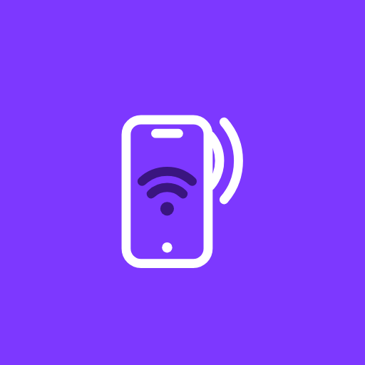
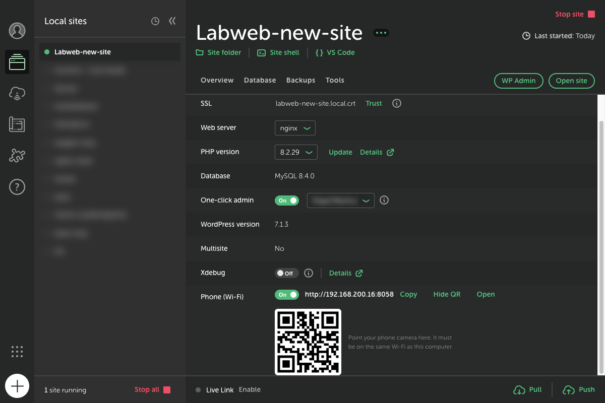
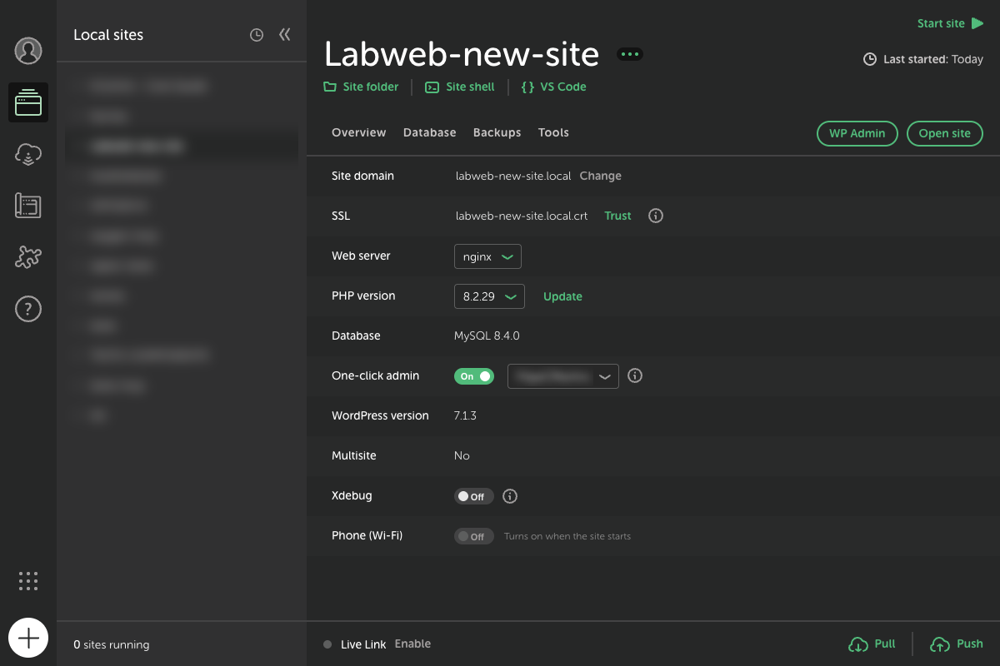

<p align="center">
  
</p>

<h1 align="center">View on Phone</h1>

<p align="center">
  An add-on for <a href="https://localwp.com">Local</a> that opens any site on your phone over Wi-Fi —
  with a fixed address and a QR code. No tunnel, no account, no changes to WordPress.
</p>

<p align="center">
  <a href="README.pt-BR.md">Leia em português</a> ·
  <a href="CHANGELOG.md">Changelog</a> ·
  <a href="https://github.com/LabWebGroup/local-addon-view-on-phone/releases">Download</a>
</p>



---

## Contents

- [Why](#why)
- [Features](#features)
- [Requirements](#requirements)
- [Installation](#installation)
- [Usage](#usage)
- [Ports](#ports)
- [How it works](#how-it-works)
- [Project structure](#project-structure)
- [Development](#development)
- [Troubleshooting](#troubleshooting)
- [Limitations](#limitations)
- [Uninstall](#uninstall)
- [License](#license)

---

## Why

Local sites answer on domains like `mysite.local`, which only exist on your computer. A phone
can't open them, and even if you use the computer's IP, WordPress redirects to the `.local`
domain and every link, stylesheet and image still points to it.

Local's **Live Link** solves this with a tunnel through the internet, but it needs an account,
it's slower and the address changes every time. View on Phone does the same inside your own
Wi-Fi network, with a fixed address per site, and works completely offline.

## Features

- **A new row on every site's Overview tab** ("Phone (Wi-Fi)"), styled like Local's own Xdebug row.
- **One switch** to turn phone access on or off per site.
- **Ready-to-use address** with **Copy**, **Open** (in your computer's browser) and **QR code** buttons.
- **Fixed port per site**: the address doesn't change between sessions.
- **Follows the site**: closes when the site stops and comes back on its own when the site
  (or Local) starts again, if it was on.
- **wp-admin login works** from the phone (cookies are adjusted).
- **Follows your IP**: if your computer's IP changes, links stay correct, because rewriting
  uses the address the phone itself typed.
- **Leaves WordPress alone**: no plugin, no database changes, no `wp-config.php` edits.
- **English and Portuguese** interface (follows the system language).

| On | Site stopped |
|---|---|
|  |  |

## Requirements

- **Local 10** or later. Developed and tested on Local **10.1.2** (macOS).
- Your phone must be on **the same Wi-Fi network** as your computer.

## Installation

### From a release (recommended)

1. Download the latest `local-addon-view-on-phone-x.y.z.tgz` from
   [Releases](https://github.com/LabWebGroup/local-addon-view-on-phone/releases).
2. In Local, go to **Add-ons › Installed** and click **Install from disk**.
3. Pick the `.tgz` file, enable **View on Phone** and relaunch Local when asked.

### From source

```bash
git clone https://github.com/LabWebGroup/local-addon-view-on-phone.git
```

Then link the folder into Local's add-ons folder (macOS):

```bash
ln -sfn "$PWD/local-addon-view-on-phone" ~/Library/Application\ Support/Local/addons/local-addon-view-on-phone
```

Add-ons folder on other systems: `%APPDATA%\Local\addons\` (Windows) and `~/.config/Local/addons/` (Linux).
Enable it under **Add-ons › Installed** and relaunch Local. There are no dependencies to install.

## Usage

1. Start the site in Local.
2. On the **Overview** tab, turn on **Phone (Wi-Fi)**.
3. Point your phone's camera at the QR code, or type the address shown.

Use the same switch to turn it off. If you only stop the site, the add-on remembers it was on
and reopens access the next time the site starts.

## Ports

Local gives each site a port in the 10000 range. The add-on uses the same ending in the 8000 range:

| Site in Local | Address on the phone |
|---|---|
| port 10058 | `http://<computer-IP>:8058` |
| port 10038 | `http://<computer-IP>:8038` |
| port 10003 | `http://<computer-IP>:8003` |

If the port is taken, the add-on tries 9xxx, then 81xx, then any free port. The chosen port is
saved and reused next time.

## How it works

```
Phone ──http://192.168.0.10:8058──▶ Bridge (inside Local) ──Host: mysite.local──▶ site web server (127.0.0.1:10058)
      ◀── HTML with links rewritten to 192.168.0.10:8058 ──┘
```

The bridge (`lib/ponte.js`) is an HTTP proxy that runs inside Local's main process:

1. **Forwards** each request to the site's web server (`127.0.0.1:<site port>`) with the `.local`
   `Host` header. `Origin` and `Referer` are converted too.
2. **Rewrites text responses** (HTML, CSS, JS, JSON, XML, SVG) and the `Location` and `Link`
   headers, replacing the `.local` domain with the address the phone used, in every form it shows up:
   - `https://mysite.local` and `http://mysite.local`
   - `https:\/\/mysite.local` (JSON with escaped slashes, common in WordPress scripts)
   - `https%3A%2F%2Fmysite.local` (URL-encoded, as in `redirect_to`)
   - `//mysite.local` (protocol-relative URLs)
3. **Adjusts cookies**: drops `domain` and `Secure` and turns `SameSite=None` into `Lax`, so login
   works over http on an IP address.
4. **Drops `Strict-Transport-Security`**, so the phone doesn't force https.
5. **Binary files** (images, fonts, video) stream through untouched.

It uses Local's official add-on hooks:

| Hook | Where | Purpose |
|---|---|---|
| `SiteInfoOverview_TableList` | renderer | Draws the "Phone (Wi-Fi)" row |
| `siteStarted` | main | Reopens the bridge if it was on |
| `siteStopped` | main | Closes the bridge (and remembers it was on) |
| `siteDeleted` | main | Closes the bridge and forgets the setting |

The screen and the main process talk over IPC (`ver-no-celular:estado`, `:ligar`, `:desligar`
and the `:mudou` notification). Per-site settings are saved in
`<Local user data>/ver-no-celular.json`.

## Project structure

```
local-addon-view-on-phone/
├── package.json            # Add-on manifest (name, productName, main, renderer, engines)
├── lib/
│   ├── main.js             # Main process: bridges, IPC, start/stop hooks
│   ├── renderer.js         # UI: "Phone (Wi-Fi)" row, switch, QR code
│   ├── ponte.js            # HTTP proxy, address rewriting, cookies, LAN IP detection
│   ├── i18n.js             # English and Portuguese strings
│   └── vendor/
│       └── qrcode-generator.js   # QR code generator (MIT, Kazuhiko Arase)
├── test/
│   └── ponte.test.js       # Bridge tests that run without Local
└── docs/
    ├── img/                # Screenshots
    ├── listing/            # Icon, cover and avatar for Local's add-on library
    └── SUBMISSION.md       # Material for the Local add-on library submission
```

No build step: plain JavaScript (CommonJS) with no runtime dependencies. The UI components
(`Switch`, `TableListRow`, `TextButton`) come from Local itself (`@getflywheel/local-components`).
The QR code library is vendored into `lib/vendor`, because Local installs an add-on from the first
`package.json` it finds in the archive, and a `node_modules` folder could get picked first.

## Development

```bash
npm test
```

```bash
npm run pack
```

`npm run pack` runs the tests and builds the `.tgz` that Local installs.

- `renderer.js` and `main.js` are only reloaded when **Local is relaunched**.
- Add-on loading is logged to `~/Library/Logs/local-lightning-verbose.log` (search for `view-on-phone`).

### Inspecting Local's UI

Local is an Electron app. To use DevTools or automate UI tests, launch it with a debugging port:

```bash
open -a Local --args --remote-debugging-port=9333
```

Then open `chrome://inspect` in Chrome. Relaunch Local normally when you're done. Add
`--lang=en-US` or `--lang=pt-BR` to see the interface in each language.

### Notes on Local 10's add-on API

- `main.js` is also loaded in helper processes (workers) that have no `ipcMain`. The add-on only
  registers its hooks when `process.type === 'browser'`.
- `context.events.send` receives the whole module: the function is under `.default`.
- `context.storage.get()` doesn't return the saved value, so the add-on uses its own JSON file.
- `@getflywheel/local-components` can't be resolved from the add-on folder. It's loaded from the
  `app.asar` path (`context.environment.appPath`).

## Troubleshooting

| Symptom | What to do |
|---|---|
| The "Phone (Wi-Fi)" row doesn't show up | Check that the add-on is enabled under **Add-ons › Installed** and relaunch Local |
| The phone can't open the address | Make sure it's on the same Wi-Fi (not mobile data, and not a "guest" network that isolates devices) |
| macOS asks whether Local may accept incoming connections | Click **Allow**. If you denied it: **System Settings › Network › Firewall › Options** and allow Local |
| Windows Firewall prompt | Allow Local on **private networks** |
| Error 503 on the first visit | WordPress is still starting. Reload in a few seconds |
| "The site did not respond" | The site is stopped in Local. Start it |
| "Not on a Wi-Fi/LAN network" | Your computer has no local network right now. Connect to Wi-Fi |
| A link or image still points to `.local` | See [Limitations](#limitations) |

## Limitations

- Works only **on the same network**. To share a site with someone outside it, use Local's Live Link.
- Access is over **http** (no padlock). Browser features that require https, such as camera,
  geolocation and service workers, won't work over the IP address.
- Addresses built in the browser (for example, JavaScript that assembles
  `"https://" + "mysite.local"` in pieces) aren't rewritten.
- **Subdomain multisite** doesn't work over an IP. Subdirectory multisite works.
- Anyone on the same network who knows the address can open the site while the bridge is on.
  Turn it off when you're done if you're on a public network.

## Uninstall

1. Disable it under **Add-ons › Installed**.
2. Remove the `local-addon-view-on-phone` folder (or link) from Local's add-ons folder.
3. (Optional) Delete `ver-no-celular.json` from Local's user data folder.

## License

[MIT](LICENSE) © Labweb. Includes [qrcode-generator](https://github.com/kazuhikoarase/qrcode-generator)
© Kazuhiko Arase (MIT).
