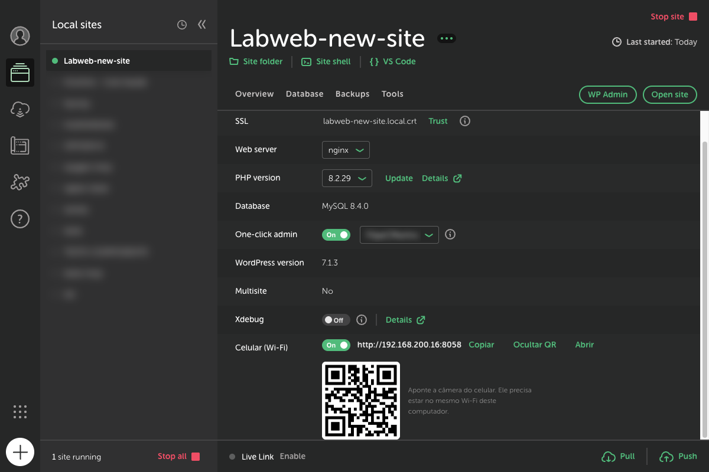
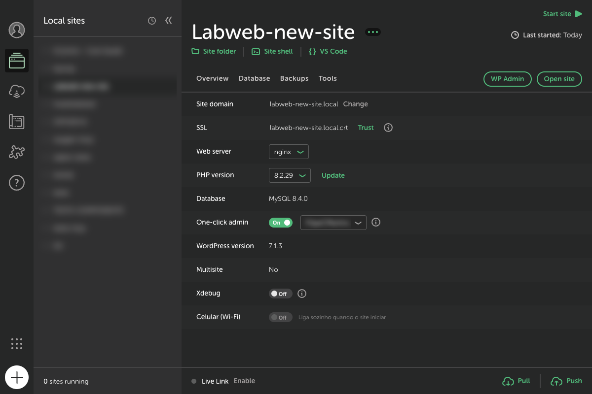

<p align="center">
  
</p>

<h1 align="center">View on Phone (Ver no celular)</h1>

<p align="center">
  Add-on para o <a href="https://localwp.com">Local</a> que abre qualquer site no celular pela rede Wi-Fi,
  com endereço fixo e QR code. Sem túnel, sem conta e sem alterar nada no WordPress.
</p>

<p align="center">
  <a href="README.md">Read in English</a> ·
  <a href="CHANGELOG.md">Changelog</a> ·
  <a href="https://github.com/LabWebGroup/local-addon-view-on-phone/releases">Download</a>
</p>



---

## Sumário

- [Por que existe](#por-que-existe)
- [Recursos](#recursos)
- [Requisitos](#requisitos)
- [Instalação](#instalação)
- [Como usar](#como-usar)
- [Portas](#portas)
- [Como funciona](#como-funciona)
- [Estrutura do projeto](#estrutura-do-projeto)
- [Desenvolvimento](#desenvolvimento)
- [Solução de problemas](#solução-de-problemas)
- [Limitações](#limitações)
- [Desinstalar](#desinstalar)
- [Licença](#licença)

---

## Por que existe

Os sites do Local respondem em domínios como `meusite.local`, que só existem no computador.
O celular não consegue abrir esses endereços. Mesmo acessando pelo IP, o WordPress redireciona
para o domínio `.local`, e todos os links, CSS e imagens continuam apontando para ele.

O **Live Link** do Local resolve isso com um túnel pela internet, mas exige conta, é mais lento e
gera um endereço diferente a cada uso. O View on Phone faz o mesmo dentro da sua rede Wi-Fi, com
um endereço fixo por site, e funciona totalmente offline.

## Recursos

- **Uma linha na aba Overview de cada site** ("Celular (Wi-Fi)"), com o mesmo visual do Xdebug.
- **Interruptor** para ligar e desligar o acesso de cada site.
- **Endereço pronto**, com os botões **Copiar**, **Abrir** (no navegador do computador) e **QR code**.
- **Porta fixa por site**: o endereço não muda entre um uso e outro.
- **Acompanha o site**: fecha quando o site para e volta sozinho quando ele (ou o Local) inicia
  de novo, se estava ligado.
- **Login no wp-admin funciona** pelo celular (os cookies são ajustados).
- **Segue o IP do computador**: se o IP mudar, os links continuam certos, porque a troca usa o
  endereço que o próprio celular digitou.
- **Não toca no WordPress**: nenhum plugin, nenhuma alteração no banco ou no `wp-config.php`.
- **Interface em inglês e português**, conforme o idioma do sistema.

| Ligado | Site parado |
|---|---|
|  |  |

## Requisitos

- **Local 10** ou superior. Desenvolvido e testado no Local **10.1.2** (macOS).
- O celular precisa estar **na mesma rede Wi-Fi** que o computador.

## Instalação

### Pelo pacote (recomendado)

1. Baixe o `local-addon-view-on-phone-x.y.z.tgz` mais recente em
   [Releases](https://github.com/LabWebGroup/local-addon-view-on-phone/releases).
2. No Local, vá em **Add-ons › Installed** e clique em **Install from disk**.
3. Escolha o arquivo `.tgz`, ative **View on Phone** e reinicie o Local quando ele pedir.

### Pelo código-fonte

```bash
git clone https://github.com/LabWebGroup/local-addon-view-on-phone.git
```

Depois, crie um link da pasta na pasta de add-ons do Local (macOS):

```bash
ln -sfn "$PWD/local-addon-view-on-phone" ~/Library/Application\ Support/Local/addons/local-addon-view-on-phone
```

Pasta de add-ons em outros sistemas: `%APPDATA%\Local\addons\` (Windows) e `~/.config/Local/addons/` (Linux).
Ative em **Add-ons › Installed** e reinicie o Local. Não há dependências para instalar.

## Como usar

1. Inicie o site no Local.
2. Na aba **Overview**, ligue **Celular (Wi-Fi)**.
3. Aponte a câmera do celular para o QR code, ou digite o endereço mostrado.

Para desligar, use o mesmo interruptor. Se você só parar o site, o add-on lembra que estava
ligado e reabre o acesso na próxima vez que o site iniciar.

## Portas

O Local dá a cada site uma porta na faixa 10000. O add-on usa a mesma terminação na faixa 8000:

| Site no Local | Endereço no celular |
|---|---|
| porta 10058 | `http://<IP-do-computador>:8058` |
| porta 10038 | `http://<IP-do-computador>:8038` |
| porta 10003 | `http://<IP-do-computador>:8003` |

Se a porta estiver ocupada, o add-on tenta a 9xxx, depois a 81xx e, por último, qualquer porta
livre. A porta escolhida fica guardada e é reutilizada nas próximas vezes.

## Como funciona

```
Celular ──http://192.168.0.10:8058──▶ Ponte (dentro do Local) ──Host: meusite.local──▶ servidor web do site (127.0.0.1:10058)
        ◀── HTML com links reescritos para 192.168.0.10:8058 ──┘
```

A ponte (`lib/ponte.js`) é um proxy HTTP que roda dentro do processo principal do Local:

1. **Encaminha** cada requisição para o servidor web do site (`127.0.0.1:<porta do site>`) com o
   cabeçalho `Host` do domínio `.local`. `Origin` e `Referer` também são convertidos.
2. **Reescreve as respostas de texto** (HTML, CSS, JS, JSON, XML, SVG) e os cabeçalhos `Location`
   e `Link`, trocando o domínio `.local` pelo endereço que o celular usou, em todas as formas em
   que ele aparece:
   - `https://meusite.local` e `http://meusite.local`
   - `https:\/\/meusite.local` (JSON com barras escapadas, comum em scripts do WordPress)
   - `https%3A%2F%2Fmeusite.local` (URL-encoded, como em `redirect_to`)
   - `//meusite.local` (URLs relativas ao protocolo)
3. **Ajusta os cookies**: remove `domain` e `Secure` e troca `SameSite=None` por `Lax`, para o
   login funcionar por http num endereço de IP.
4. **Remove o `Strict-Transport-Security`**, para o celular não forçar https.
5. **Arquivos binários** (imagens, fontes, vídeos) passam direto, sem alteração.

O add-on usa os ganchos oficiais do Local:

| Gancho | Onde | Para quê |
|---|---|---|
| `SiteInfoOverview_TableList` | renderer | Desenha a linha "Celular (Wi-Fi)" |
| `siteStarted` | main | Religa a ponte se ela estava ligada |
| `siteStopped` | main | Fecha a ponte (e lembra que estava ligada) |
| `siteDeleted` | main | Fecha a ponte e apaga a preferência |

A tela e o processo principal conversam por IPC (`ver-no-celular:estado`, `:ligar`, `:desligar`
e o aviso `:mudou`). A preferência de cada site fica em
`<pasta de dados do Local>/ver-no-celular.json`.

## Estrutura do projeto

```
local-addon-view-on-phone/
├── package.json            # Manifesto do add-on (name, productName, main, renderer, engines)
├── lib/
│   ├── main.js             # Processo principal: pontes, IPC, ganchos de iniciar/parar
│   ├── renderer.js         # Tela: linha "Celular (Wi-Fi)", interruptor, QR code
│   ├── ponte.js            # Proxy HTTP, reescrita de endereços, cookies, IP da rede
│   ├── i18n.js             # Textos em inglês e português
│   └── vendor/
│       └── qrcode-generator.js   # Gerador de QR code (MIT, Kazuhiko Arase)
├── test/
│   └── ponte.test.js       # Testes da ponte sem precisar do Local
└── docs/
    ├── img/                # Prints
    ├── listing/            # Ícone, capa e avatar para a biblioteca de add-ons do Local
    └── SUBMISSION.md       # Material para o envio à biblioteca de add-ons do Local
```

Não há etapa de build: é JavaScript puro (CommonJS), sem dependências em tempo de execução. Os
componentes visuais (`Switch`, `TableListRow`, `TextButton`) vêm do próprio Local
(`@getflywheel/local-components`). A biblioteca de QR code fica embutida em `lib/vendor`, porque o
Local instala o add-on a partir do primeiro `package.json` que encontra no pacote, e uma pasta
`node_modules` poderia ser escolhida antes.

## Desenvolvimento

```bash
npm test
```

```bash
npm run pack
```

O `npm run pack` roda os testes e gera o `.tgz` que o Local instala.

- O `renderer.js` e o `main.js` só são recarregados quando o **Local é reiniciado**.
- O carregamento do add-on fica no log `~/Library/Logs/local-lightning-verbose.log`
  (procure por `view-on-phone`).

### Inspecionar a tela do Local

O Local é um app Electron. Para usar o DevTools ou automatizar testes na interface, abra o Local
com a porta de depuração:

```bash
open -a Local --args --remote-debugging-port=9333
```

Em seguida, abra `chrome://inspect` no Chrome. Feche e reabra o Local normalmente ao terminar.
Acrescente `--lang=en-US` ou `--lang=pt-BR` para ver a interface em cada idioma.

### Detalhes da API de add-ons do Local 10

- O `main.js` também é carregado em processos auxiliares (workers), onde não há `ipcMain`. O
  add-on só registra os ganchos quando `process.type === 'browser'`.
- `context.events.send` recebe o módulo inteiro: a função fica em `.default`.
- `context.storage.get()` não devolve o valor salvo, por isso o add-on usa um JSON próprio.
- `@getflywheel/local-components` não é encontrado a partir da pasta do add-on. Ele é carregado
  pelo caminho do `app.asar` (`context.environment.appPath`).

## Solução de problemas

| Sintoma | O que fazer |
|---|---|
| A linha "Celular (Wi-Fi)" não aparece | Confira se o add-on está ativo em **Add-ons › Installed** e reinicie o Local |
| O celular não abre o endereço | Confirme que ele está no mesmo Wi-Fi (sem dados móveis e sem "Wi-Fi de convidados", que isola os aparelhos) |
| O macOS pergunta se o Local pode receber conexões | Clique em **Permitir**. Se negou antes: **Ajustes › Rede › Firewall › Opções** e libere o Local |
| Aviso do Firewall do Windows | Permita o Local em **redes privadas** |
| Erro 503 na primeira visita | O WordPress ainda está iniciando. Recarregue em alguns segundos |
| "O site não respondeu" | O site está parado no Local. Inicie o site |
| "Computador sem rede Wi-Fi/cabo" | O computador está sem rede local. Conecte ao Wi-Fi |
| Algum link ou imagem ainda aponta para `.local` | Veja as [limitações](#limitações) |

## Limitações

- Funciona só **na mesma rede**. Para mostrar o site a alguém fora dela, use o Live Link do Local.
- O acesso é por **http** (sem cadeado). Recursos do navegador que exigem https, como câmera,
  geolocalização e service workers, não funcionam pelo IP.
- Endereços montados no próprio navegador (por exemplo, JavaScript que junta
  `"https://" + "meusite.local"` em partes) não são reescritos.
- **Multisite por subdomínio** não funciona por IP. Multisite por subpasta funciona.
- Qualquer pessoa na mesma rede que souber o endereço consegue abrir o site enquanto a ponte
  estiver ligada. Desligue ao terminar se estiver numa rede pública.

## Desinstalar

1. Desative em **Add-ons › Installed**.
2. Apague a pasta (ou o link) `local-addon-view-on-phone` da pasta de add-ons do Local.
3. (Opcional) Apague `ver-no-celular.json` da pasta de dados do Local.

## Licença

[MIT](LICENSE) © Labweb. Inclui o [qrcode-generator](https://github.com/kazuhikoarase/qrcode-generator)
© Kazuhiko Arase (MIT).
